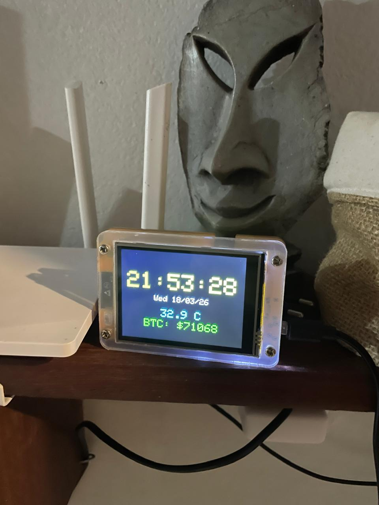

# CYD Rolling Clock

Relógio digital com temperatura ambiente em tempo real, rodando em ESP32 com display TFT colorido.



---

## Funcionalidades

- Hora sincronizada via **NTP** (atualização a cada 5 minutos)
- Animação de **rolagem vertical** nos dígitos ao mudar
- Exibição de **data** (DD/MM/YYYY) e dia da semana
- **Temperatura ambiente** lida pelo sensor DHT22 e exibida na tela
- **Preço do Bitcoin** em tempo real via API da Binance (atualização a cada 60 segundos)
- Suporte a múltiplas redes WiFi

---

## Hardware

| Componente | Especificação |
|---|---|
| Microcontrolador | ESP32 (CYD — Cheap Yellow Display) |
| Display | TFT 320×240, driver ILI9341 |
| Sensor de temperatura | DHT22 (AM2302) |

### Pinagem

| DHT22 | ESP32 |
|---|---|
| VCC | 3.3V |
| GND | GND |
| DATA | GPIO 22 |

---

## Esquema de ligação

```
ESP32                DHT22
──────               ─────
3.3V  ──────────────  VCC
GND   ──────────────  GND
GPIO22 ─────────────  DATA
                      (resistor 10kΩ entre VCC e DATA)
```

---

## Como funciona

### Sincronização de hora (NTP)

O firmware conecta ao WiFi e consulta o servidor `us.pool.ntp.org` via UDP na porta 123. O pacote NTP retorna o timestamp em segundos desde 1900, que é convertido e ajustado ao fuso horário local. A sincronização acontece automaticamente a cada 5 minutos.

### Leitura de temperatura (DHT22)

O sensor DHT22 usa protocolo serial de 1 fio. A cada segundo, o firmware solicita uma leitura ao sensor. Leituras inválidas (`NaN`) são descartadas — a última leitura válida permanece na tela até uma nova leitura bem-sucedida.

```
loop() a cada 1s
   └── dht.readTemperature()
         ├── válida → atualiza temperatura → DrawTemperature()
         └── NaN    → mantém último valor
```

### Preço do Bitcoin (Binance API)

A cada 60 segundos, o firmware faz uma requisição HTTP GET para a API pública da Binance:

```
GET https://api.binance.com/api/v3/ticker/price?symbol=BTCUSDT
```

Resposta:
```json
{"symbol":"BTCUSDT","price":"71068.00000000"}
```

O valor é parseado com ArduinoJson e exibido na tela em verde. Entre atualizações, o último preço conhecido permanece na tela.

```
loop() a cada 60s
   └── fetchBitcoinPrice()
         ├── HTTP 200 → parse JSON → atualiza btcPrice → DrawBitcoinPrice()
         └── falha    → mantém último valor
```

### Animação dos dígitos

Cada dígito é renderizado em um sprite independente. Ao mudar de valor, o sprite faz scroll vertical frame a frame — o dígito antigo sobe enquanto o novo entra por baixo.

---

## Dependências (Arduino IDE)

- [TFT_eSPI](https://github.com/Bodmer/TFT_eSPI)
- [Time](https://github.com/PaulStoffregen/Time)
- [Timezone](https://github.com/JChristensen/Timezone)
- [DHT sensor library](https://github.com/adafruit/DHT-sensor-library)
- [Adafruit Unified Sensor](https://github.com/adafruit/Adafruit_Sensor)
- [ArduinoJson](https://github.com/bblanchon/ArduinoJson)

---

## Configuração

### 1. Credenciais WiFi

Copie o arquivo de exemplo e preencha com sua rede:

```bash
cp secrets.h.example secrets.h
```

Edite `secrets.h`:

```cpp
String credentials[][2] = {
    {"NOME_DA_REDE", "SENHA_WIFI"},
};
```

> `secrets.h` está no `.gitignore` e nunca será commitado.

### 2. TFT_eSPI

No arquivo `User_Setup.h` da biblioteca TFT_eSPI, configure os pinos conforme sua placa CYD. Configurações de referência para CYD disponíveis [aqui](https://github.com/witnessmenow/ESP32-Cheap-Yellow-Display).

### 3. Fuso horário

Em `RELOGIOESP.ino`, ajuste as regras de timezone:

```cpp
TimeChangeRule myStandardTime = {"BRT", First, Sun, Nov, 2, -3 * 60};  // UTC-3
```

---

## Fotos

| Vista frontal |
|---|
|  |

---

## Licença

MIT
